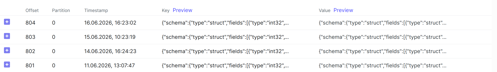

# CDC Pipeline — BI-метрики на данных библиотеки

## Выбор таблицы

Выбрана таблица **`fines`** (штрафы за просрочку книг).

- Растёт при каждой просрочке возврата книги
- Содержит числовой показатель: `amount` (сумма штрафа)
- Содержит категорию: `payment_status` (оплачен / не оплачен)
- Связана с `loans` через `loan_id` — можно отслеживать динамику во времени

**Поля для метрик:**
| Поле | Тип | Использование |
|------|-----|---------------|
| `id` | SERIAL | идентификатор |
| `loan_id` | INTEGER | связь с выдачей |
| `amount` | DECIMAL(10,2) | сумма штрафа |
| `payment_status` | BOOLEAN | статус оплаты |

