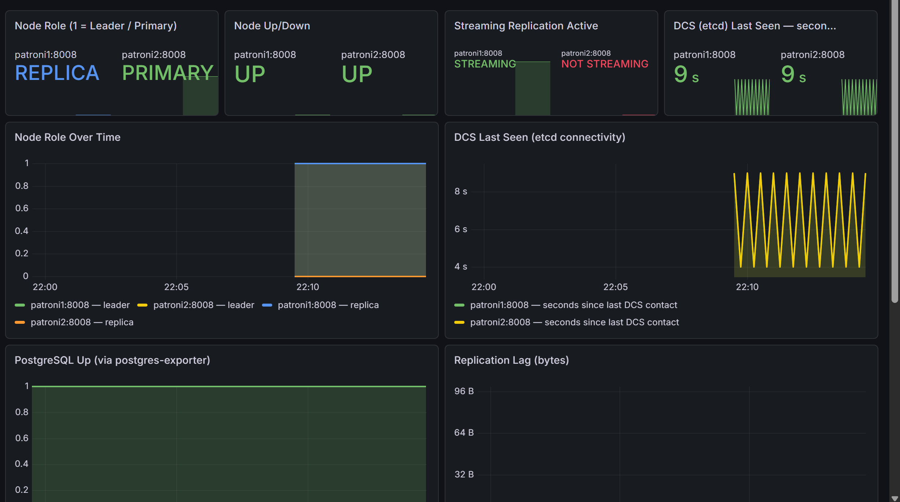
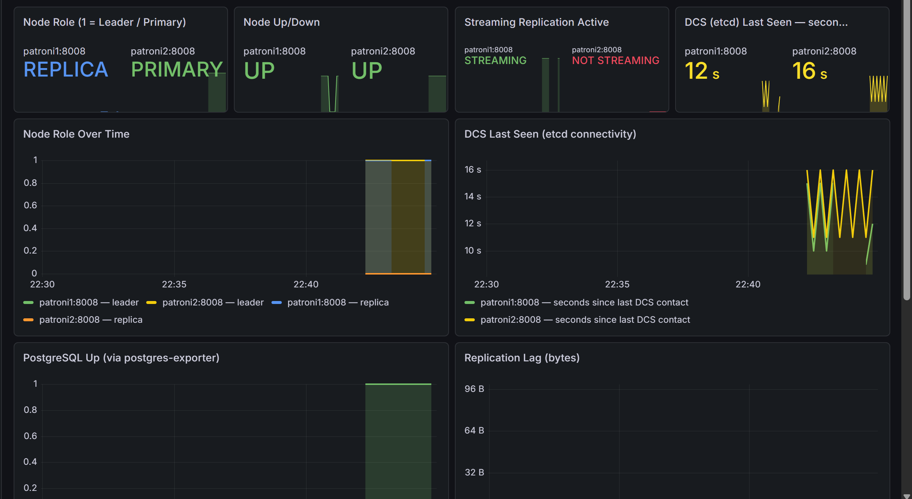
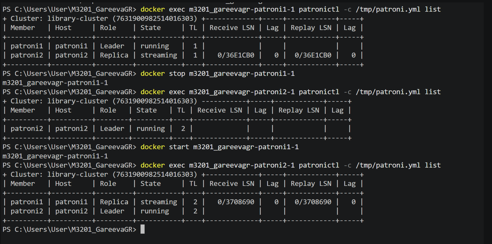
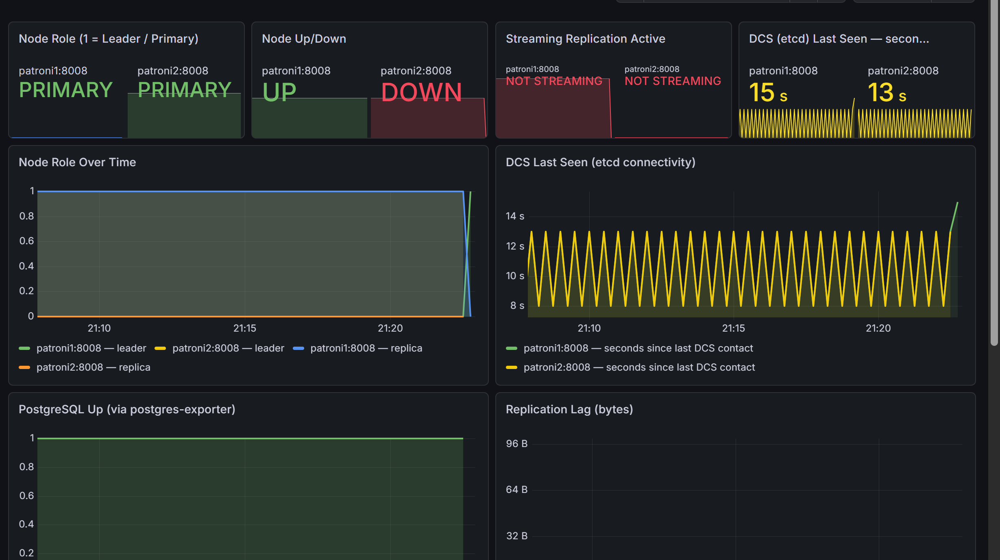
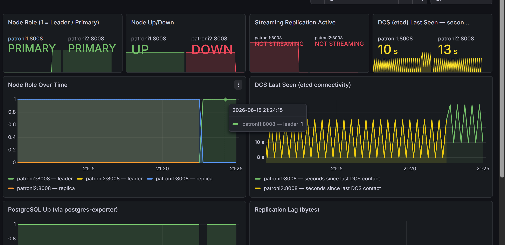
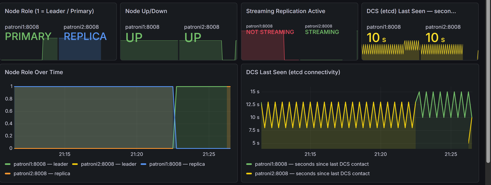
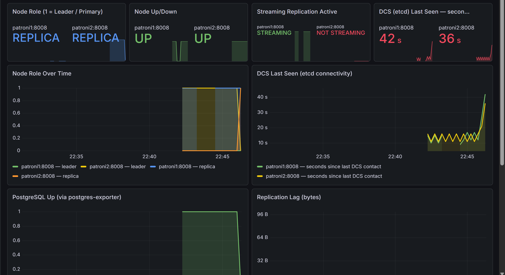
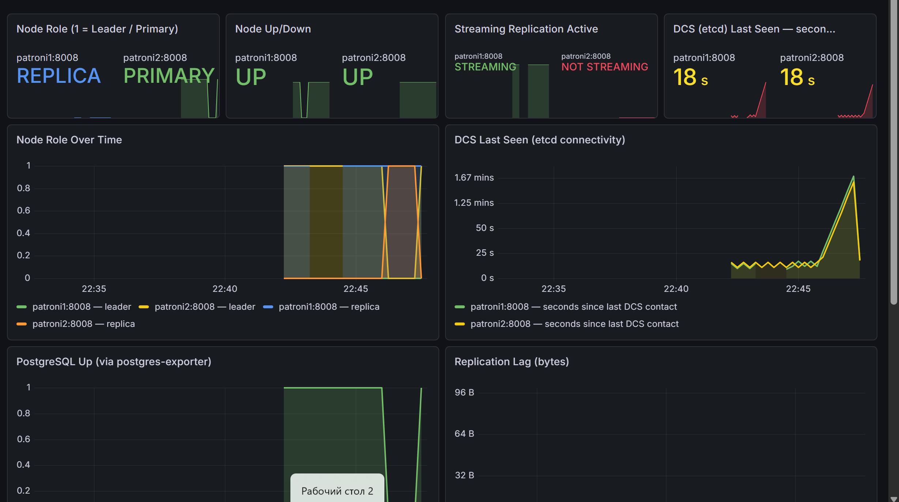

## Изначально

## Сценарий 1 — Отказ Primary PostgreSQL

До отказа:
- patroni1: replica
- patroni2: primary
- PostgreSQL доступен через HAProxy: 172.22.0.5 | pg_is_in_recovery=false

Восстановление:
- patroni1 стартовал обратно как replica
- Кластер: patroni1=replica, patroni2=primary
- PostgreSQL доступен

Итог:
- Failover успешный
- Ошибок подключения у клиентов не было
- Система восстановилась автоматически

## Сценарий 2 — Потеря связи с etcd (изоляция DCS)

До отказа:
- etcd: healthy
- patroni1: replica, dcs_last_seen=1780771645
- patroni2: primary, dcs_last_seen=1780771646
- PostgreSQL доступен: ok | f

Инъекция: docker stop etcd в 21:47:29

Поведение при недоступном DCS:
- оба узла продолжают работать в прежних ролях
  (patroni1=replica, patroni2=primary), dcs_last_seen не обновляется
- PostgreSQL доступен через HAProxy всё это время
- появляется "cluster_unlocked": true — Patroni зафиксировал
  потерю блокировки лидера в etcd
- patroni2 перестал быть primary, оба узла перешли в replica
- PostgreSQL стал недоступен (CONNECTION FAILED) — HAProxy не нашёл primary

Ручной failover без DCS: невозможен (etcd недоступен)

Восстановление после возврата etcd:
- etcd поднялся, Patroni переподключился
- patroni2 снова стал primary
- patroni1 снова replica, streaming
- PostgreSQL доступен

Итог:
- Failover без DCS невозможен - намеренное поведение против split-brain
- При потере etcd кластер продолжает работать до истечения TTL, затем все узлы становятся replica и БД недоступна
- После возврата etcd система восстановилась автоматически
- Новый leader выбран нормально patroni2

* "cluster_unlocked": true — это именно тот момент когда Patroni понял что никто не держит лок лидера в etcd. Primary остановил PostgreSQL чтобы не допустить ситуации когда два узла думают что они primary (split-brain).